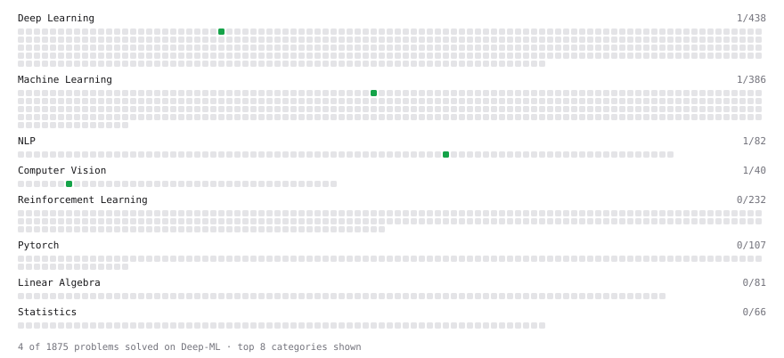

# Deep-ML

My machine learning practice from [Deep-ML](https://www.deep-ml.com). Every solution here was written by hand.

**3** solved · 3 problems · 0 labs · 0 math

[**Browse the interactive portfolio**](https://DatDoan0804.github.io/deep-ml/) to replay this filling in over time.

## Problems

| | Difficulty | Solved | |
| --- | --- | --- | --- |
| [Apply Zero Padding to an Image](https://www.deep-ml.com/problems/239) | easy | 2026-11-01 | [solution](problems/0239-apply-zero-padding-to-an-image) |
| [Build Bigram Count Matrix from Words](https://www.deep-ml.com/problems/983) | easy | 2026-10-29 | [solution](problems/0983-build-bigram-count-matrix-from-words) |
| [Implement the Swish Activation Function](https://www.deep-ml.com/problems/102) | easy | 2026-11-01 | [solution](problems/0102-implement-the-swish-activation-function) |

---

_This file is regenerated by Deep-ML on every push._
